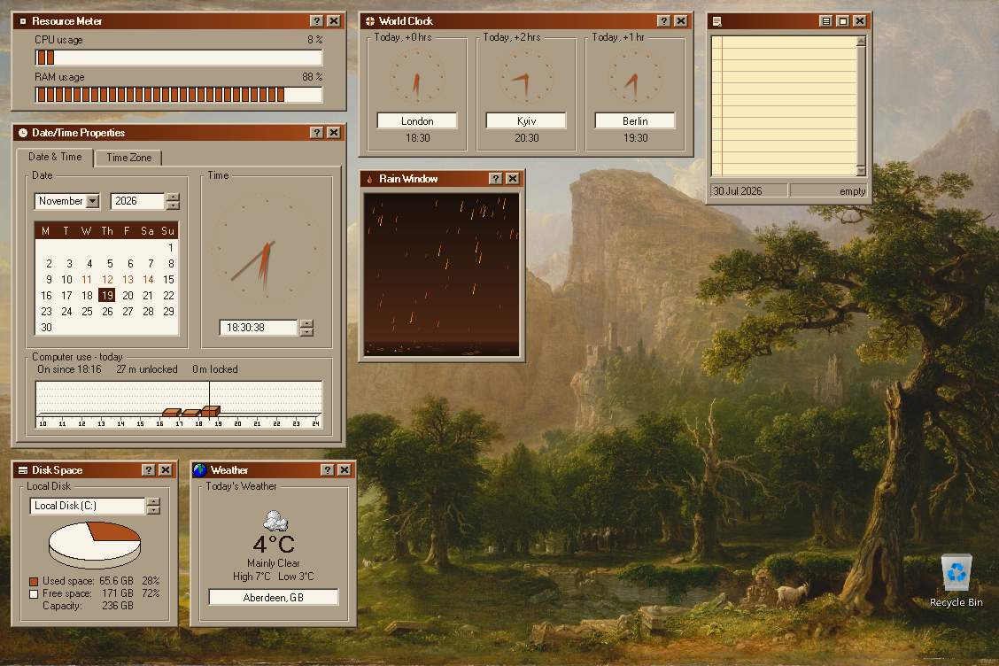
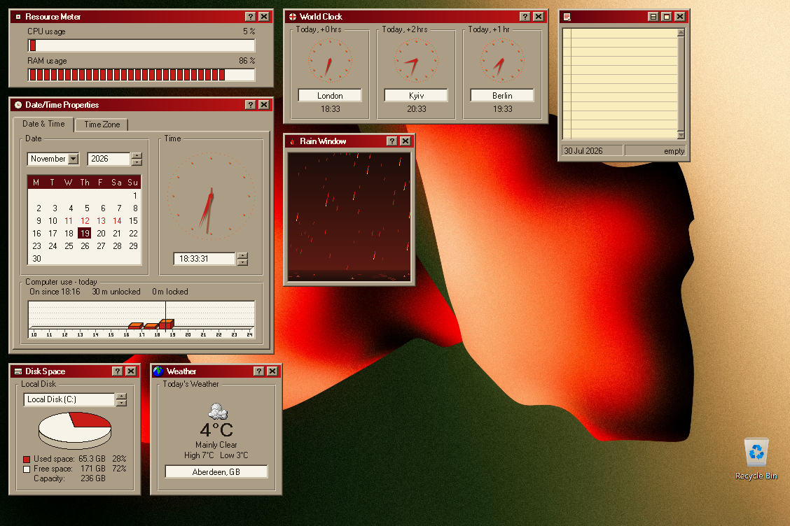
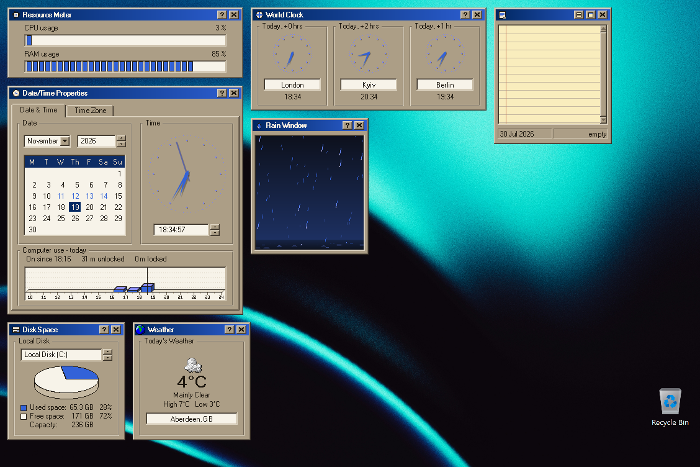

# Win98 Widgets

Ten Windows 98 style desktop widgets — Date/Time Properties, Resource Meter, Sticky Note,
Weather, Rain Window, Disk Space, World Clock, Battery, Countdown and Claude Usage — as one
small Rust program. There is one of each, and as many more Sticky Notes and Countdowns as you ask for.



Down the left, the **Resource Meter** (how busy the processors are and how full the
memory is), **Date/Time Properties** (a calendar, a clock and a graph of when the computer
was in use today) and, along the bottom, **Disk Space** and **Weather**. In the middle the
**World Clock** keeps the time in three cities, with the **Rain Window** under it; on the
right, a **Sticky Note**. The same desktop in two of the other colours is further down,
under *Colour*. The **Battery**, the smallest, the **Countdown** and **Claude Usage** came
after these pictures were taken.

| | |
|--------------------------|---------|
| private memory           | ~2.5 MB |
| working set              | 2–3 MB idle |
| run-time dependencies    | none |
| program                  | one 700 KB .exe |

Measured with the first four widgets showing, before Rain Window and Disk Space were added.

## Build and run

```text
cargo build --release        ->  target\release\win98-widgets.exe
```

crates; the only build-time one is `png`, used to decode the weather icons.

Run the .exe. Nothing is installed: it can live anywhere. Only one copy runs at a time.

## The widgets are the skins

Each widget's layout is an `.ini` file in [`skins/`](skins): a `[Variables]` section for the
palette and the layout figures, then one section per meter — a shape, a line of text or an
image — in the order they are painted. `build.rs` compiles the ten of them into static
tables — every meter's position, shapes, colours, text options and mouse actions — so
**the `.ini` files are the single source of truth for the layout**. Change a colour or move
a meter there, rebuild, and the widget follows. Nothing parses an `.ini` while the program
runs: the logic behind each widget is plain Rust in `src/widgets/` (`datetime.rs`,
`resources.rs`, `notes.rs`, `weather.rs`, `rain.rs`, `disk.rs`, `world.rs`, `battery.rs`,
`countdown.rs`, `claude.rs`), and a mouse action in a skin, such as
`LeftMouseUpAction=Select(7)`, names the command that logic answers to.

Text is laid out by DirectWrite and rasterised with aliased glyphs, set the way Windows 98's
GDI set it: a whole-pixel font size (8 pt is 11 px), letters a whole number of pixels wide,
and no kerning, so every glyph starts on a pixel and the gaps between letters are even.
Shapes are filled by a small software canvas.

`--dump <dir> [--state <file>]` draws each widget off-screen, in a state given by the
file (which can ask for more than one note or countdown), and writes it out as a BMP — for comparing
before and after a change (see `src/tools/dump.rs`).

**Scaled displays.** The skins are laid out in whole pixels, and stretching them by 225% would
blur every edge. So the program draws each widget itself at a whole number of times its
size: its monitor's scale setting rounded to the nearest whole number. That is 1 at 100% and
125%, 2 at 150% to 225%, and 3 at 250% to 300%. Every pixel of a skin becomes a square block
of the screen's. On a monitor whose setting is not a whole number, the widgets come out a
little smaller or larger than the rest of what is on it (at 225%, 2/2.25 of the size). A
widget dragged onto a monitor with another scale takes that scale. A `settings.ini` from a
build before this one, which was not DPI aware, has its places converted once, keeping each
widget where it was on its monitor, and then gets `DevicePixels=1` under `[General]`. Add
`scale=2` to a `--dump` state file to see the widgets as a monitor at 2x shows them.

## Using them

They are desktop widgets, not windows: no taskbar button, not in Alt-Tab, and they never
take the keyboard (except the note, the city fields and a countdown's name, while you
type in them).

| | |
|--|--|
| drag anywhere | move a widget; it snaps onto the grid — the screen margin and the gap between widgets — and into line with the others (hold Ctrl or Shift not to). The note's text is the exception: dragging there selects |
| right-click | menu: the widget's own options, Position, Snap, Screen margin, Gap between widgets, Colour, Lock, Close, the list of widgets (with *Sticky Note +* and *−* for the notes, and *Countdown +* and *−* for the countdowns), Start with Windows, settings, Exit |
| tray icon | the same menu — this is how a closed widget is brought back |
| `X` | closes that widget (it stops costing anything); `?` says what it does |

Each widget stays where you put it, on whichever monitors you have. When a monitor is
unplugged, moved or rescaled, any widget it would hide is moved to the nearest monitor,
by as little as needed and together with the widgets near it, so a layout arrives in
one piece. Its saved place is left alone: when the monitor comes back, the widget goes
back to that place.

**The grid.** Widgets are laid out on two figures, both measured between the frames
you see: the *screen margin*, bare screen between a widget and the edge of its monitor
(12 px unless changed), and the *gap between widgets* (24 px). Right-click → *Screen
margin* or *Gap between widgets* offers 0 to 32 px; any other figure, up to 200, can be
written into `settings.ini` as `ScreenMargin=` and `WidgetGap=` under `[General]` and
picked up with *Reload settings*. When one changes, the widgets on the grid move with
it: a widget against the screen's edge stays against it, the ones beside it or under it
follow on at the new gap, and ones lined up with each other stay lined up. "On the grid"
means no further from the edge or the neighbour than the old figure and 10 px more, near
enough to have been snapped there. A widget placed further away stays where it is, and
so does a closed one. The first layout and the place of a new note or countdown follow
the same two figures. A widget is kept at least the margin inside the screen. Both figures are in the
widgets' own pixels: on a monitor where they are drawn at 2x, a 12 px margin is 24 of the
screen's.

**Colour.** The widgets are drawn in rust and gold unless another colour is picked:
right-click → *Colour* has the warm Rust, Brick, Orange, Mustard, Olive, Mauve and Taupe,
then the cool Navy, Teal, Slate and Graphite, each with a swatch, and *Custom...*, which
opens the Windows colour dialog for any other. Every widget changes at once, and the
choice is kept in `settings.ini` as `Tint=` under
`[General]` — `R,G,B` or `#RRGGBB`, written there by hand if you like and picked up with
*Reload settings*; empty is the rust. The colour is the accents': the title bars, the
calendar's heading and the selected day, the clocks' hands and dots, the usage bars, the
used part of the disk pie, the rain, the Claude Usage needles. The greys and whites of the
windows themselves — faces, bevels, fields — and the text stay exactly as they are, and so
do the note's papers with the red margin printed on them, the weather's icons, the
countdown's hourglass and its red pen ring, the battery's sections, red to green, and the
Claude Usage scales, green to red, which have to mean the same whatever the colour. An
accent takes the
colour's hue and how colourful it is, but keeps its own lightness, so the white text on
a title bar stays as readable as it was; a very pale or very dark colour therefore comes
out in between (navy gives a title bar that runs from navy to blue). The swatches show
the colour as the widgets will have it. The skins' accents are all drawn around one
colour, the `Tint` variable in each `skins/*.ini`, and what a skin keeps as it is is
listed there as `Untinted=`.

<p>
  
  
</p>

Brick and Navy: the title bars, hands, bars, pie and rain change; the grey faces, the white
fields, the text and the note's paper do not.

In the widgets themselves: tabs, month list, calendar selection, scroll to browse months,
the 12/24-hour field, scroll along the usage graph's hours, checkboxes, the scrollbar,
the paper swatch and the ruled-paper button, typing on the note with save-as-you-type and
a `.bak`, the weather's city field, and a countdown's calendar and name field.

**The usage graph.** The Date/Time graph shows part of the day, 07:00 to 21:00 unless
`GraphFrom=` and `GraphTo=` under `[DateTime]` in `settings.ini` say otherwise. The wheel
over it moves those hours along the day, an hour a notch — up for earlier, down for later,
and sideways too, with a tilting wheel or a touchpad: left for earlier, right for later —
as far as midnight at either end, and a double-click brings the usual hours back. Under
the blocks is a ruler: a mark where each hour begins, with the hour's figure under it in
small pixel figures — `07`, or `7A` on the 12-hour clock — and a shorter mark at each
half past. The hours in
view stay put while other days are picked in the calendar; a restart starts from the
usual ones again.

**Typing on the note.** Click the text and type: the caret goes where you clicked, and
the note looks the same as it did before you clicked — same line breaks, checkboxes still
in the margin, done items still struck through. Drag or Shift+arrows to select,
double-click for a word, Ctrl+C/X/V, Ctrl+Z/Y to undo and redo. Type `[ ]` at the start
of a line to make a checkbox; Enter on a checkbox line starts another (on an empty one it
ends the list), and Backspace at the start of one removes the checkbox. A click anywhere
else, or Escape, finishes; the note is saved a second after you stop typing and again
when you finish.

**The note's paper.** The swatch button in the note's title bar moves on to the next
paper colour each time it is clicked — canary, white, pink, green, blue, orange, lilac,
and round to canary again — and the note remembers which. The colours are the `Paper1`,
`Paper2`, … variables in `skins/Win98Notes.ini`; another line there is another colour.

**More than one note.** The other widgets are ticked on and off in the Widgets list; the
notes are counted there instead. *Sticky Note +* puts one more note on the screen and
*Sticky Note −* takes one off — the note the menu was opened on, or else the last one.
A note taken off, or closed with its `X`, keeps its text, and `+` brings those back first,
where they were, before it makes a new one; a new one goes beside the note the menu was
opened on (or the last one), in the nearest place where there is room. Each note has its
own text, its own paper and ruling and its own place; none has a title — the bar is the
icon and the buttons. Right-click a note after the first → *Delete this note* removes it
for good: its text file goes to the Recycle Bin, after a question if there is anything
written on it. The first note is the one that is always there: it can be closed but not
deleted. Countdowns are counted the same way, with *Countdown +* and *Countdown −*, and
one after the first can be deleted with *Delete this countdown* (after a question if it
counts to a day or has a name).

**The weather's city.** Click the city field and type a place: `Lviv`, or `Paris, US` /
`Portland, Maine` to say which one. Enter (or a click anywhere else) looks it up and pins
the forecast to it; Escape leaves things as they were; an empty field goes back to the
place your public IP address gives. The pin is kept in `settings.ini` as `ManualLat`,
`ManualLon` and `ManualLocation`, which can also be written by hand.

**Rain Window** does nothing: it is rain the colour of rust (or of the colour picked)
falling past a small dark window, the size of the Sticky Note, to be looked at. Right-click it for how hard it
rains — *Light*, *Steady*, *Heavy* — and to *Pause* it; both are kept in `settings.ini`
as `Rate` and `Paused`. Its colours are the `Rain*` variables in `skins/Win98Rain.ini`.

**Disk Space** shows how full one drive is: the space used and free on it, its capacity,
and the two as the pie from a drive's Properties page — the free space is the pale slice.
The arrow buttons beside the drive's name step to the drive before and the one after, as
does the wheel over the name; right-click has every drive by its letter. The choice is
kept in `settings.ini` as `Drive`; with none made it is the drive Windows is on. The
pie's colours are the `Pie*` variables in `skins/Win98Disk.ini`.

**World Clock** keeps the time in three cities, side by side: each has its hands, the time
in figures, and on its box whether it is today there and how far ahead of here it is
("Today, +2 hrs"). Click a city's name and type another — `Lviv`, or `Paris, US` /
`Portland, Maine` to say which one; Enter takes it, Escape does not, and an empty field
puts that clock away. A city is looked up once, with Open-Meteo, for the time zone it
keeps; after that its time is worked out on this machine, summer time and all. The three
are kept in `settings.ini` as `City1`/`Zone1` to `City3`/`Zone3` under `[World]`, and the
figures follow the Date/Time widget's 12- or 24-hour choice.

**Battery** is the smallest widget, 120 px wide and as tall as Weather and Disk Space. It
shows how much charge is left as a battery cell standing on end, seen from a little above:
a flat metal top with the terminal standing up from it, a metal band round the top of the
side and another round its foot, and between them five sections, a fifth of the charge
each, that light up from the bottom, red at the foot through orange and yellow to green at
the top, so the less is left the redder it is.
It is drawn the way pixel art draws a cylinder, with no outline: shaded in stripes down its
length with the shine of a reflection, and every edge across it curving round. The
sections stand apart like discs on a spindle, the battery's narrower metal core showing in
the space between them. The sections not lit are dark grey, and any charge at all lights
at least one. A bolt on the battery means it is charging. Under the battery are the
percentage and a *Status* row: a plug while it is plugged in, with a small bolt beside it
while it charges, or on battery the time left ("2h 15m", or "..." until Windows has worked
it out). A machine with no battery shows a dark one, "--" and the plug, since it runs on
the mains. The battery's shape, colours and shading are the `Batt*` and `Cell*` variables
in `skins/Win98Battery.ini`.

**Countdown** counts the days to a day you pick. Its top box is the Date/Time widget's
calendar, the same month list, year arrows and grid, with today in the dark block: click
a day and the countdown counts to it, and that day is ringed in red whenever its month is
on show — as by hand with a pen: centred on the number, a little lopsided, and not closed,
its end running on past its start with a flick. The wheel over the grid or the month field browses, and a
double-click on the grid goes back to the month counted to. Under the calendar are the
count, big — the days left from today, *Today* on the day itself, 0 once it has gone by,
moving on at midnight — the day counted to in full ("Friday, 27 November 2026"), and a
field to type what the day is: click it and type, Enter takes it, Escape does not. The
week starts on the day the Date/Time widget's starts on. Each countdown keeps its day and
its name in `settings.ini` as `Date=2026-11-27` and `Name=` under its own section,
`[Countdown]`, `[Countdown2]`, …

**Claude Usage** shows how much of a Claude plan's two usage limits has been used: the
*session*, which lasts five hours from its first message, and the *week*. Each is a gauge
in a box of its own, side by side, after a car's fuel gauge and drawn in the Battery's
light: a dark face under glass in a raised metal bezel, a scale of ten rounded segments
round it, a tenth of the limit each, that light up from green through yellow to red as far
as the reading goes — the Battery's colours the other way about, so the more is used the
redder it is — and a needle in the accent colour on a domed hub, throwing its shadow on
the face. Nothing is outlined. The percentage stands at the foot of the face, and under
each gauge is how long until that limit resets: "3h 57m till reset", "14h till reset",
"1d 8h till reset". They are the same figures as `/usage` in Claude Code, and they are
asked for the same way: with
the sign-in Claude Code keeps in `%USERPROFILE%\.claude\.credentials.json` (or in the
folder `CLAUDE_CONFIG_DIR` names), from api.anthropic.com, every five minutes and a minute
after a limit resets. Nothing else is sent anywhere. That address is the one Claude Code
itself uses and is not a published API, so a change at Anthropic's end can stop the widget
until it is updated; the line under each gauge then says *Unreadable*. The sign-in is only
ever read, never renewed — renewing it would use up the renewal Claude Code holds and sign
Claude Code out — so when it runs out the figures stay as they were and the line says
*Signed out*; open Claude Code, and as soon as it has signed in again they are brought up
to date. While there is no answer it says *Offline*. Right-click → *Refresh now* asks at
once. The gauges' shape, colours and shading are the `Dial*`, `Scale*`, `Needle*` and
`Segment*` variables in `skins/Win98Claude.ini`.

**Position** (right-click → Position): *On desktop* (default) keeps the widgets behind
every window; *Normal*; *Always on top*.

## Where things are kept

| | |
|--|--|
| `%APPDATA%\Win98Widgets\settings.ini` | positions, which widgets are shown, each widget's knobs, and the countdowns' days and names |
| `%APPDATA%\Win98Widgets\Notes.txt` | the note (`NoteFile=` in settings.ini to keep it elsewhere) |
| `%APPDATA%\Win98Widgets\Notes2.txt`, `Notes3.txt`, … | the notes after the first, each with a `[Notes2]`, `[Notes3]`, … section of its own in settings.ini |
| `%LOCALAPPDATA%\Win98DateTime\Usage.log`, or `%LOCALAPPDATA%\Win98DateTime.log` | the usage log |
| `%LOCALAPPDATA%\Win98Widgets\weather.txt` | the last forecast |
| `%LOCALAPPDATA%\Win98Widgets\claude.txt` | the last Claude usage figures (never the sign-in) |

A `settings.ini` beside the .exe is used instead, if there is one (a portable copy).

## How they behave

- **Locked or not** comes from Windows' own session notifications. Old log entries are
  still run through a 30-second filter for momentary false "unlocked" readings.
- **The sign-in time** is read in UTC, so "date the session from sign-in" holds in every
  time zone.
- **The second hand** moves on the second: the tick is re-aimed at each second's start.
- **Weather** shows the last forecast immediately after a restart, and each fetch runs in
  a short-lived child process, so the networking libraries are never resident.
- **Nothing is drawn while the workstation is locked**; the usage log keeps running.
- **Rain Window is the one widget drawn more than once a second**: 25 frames a second, of
  its pane only, from a timer that runs only while there is rain to show — not while it
  is paused or closed, nor while the workstation is locked. A frame takes about a fifth
  of a millisecond to draw.
- **Battery** asks Windows how the power stands once a second, which is one call, and
  repaints only when something it shows has changed: a tenth of the charge, a percent, the
  power source, or a minute of the time left.
- **Claude Usage** asks for its figures from a short-lived child process, like the
  weather, every five minutes; in between it only moves the reset times on, once a
  minute. While Claude Code's sign-in has run out it asks nothing, and only looks every
  15 seconds at when the sign-in file was last changed — never at what is in it.
- **Disk Space** asks a drive on this machine for its figures every five seconds, and
  repaints only when a figure it shows has changed. A network drive, a disc or a card can
  take many seconds to answer, so those are asked every half minute from a thread that
  lasts as long as the one question: no widget waits for a drive.
- The note is wrapped by the widths DirectWrite gives for the font it is drawn in, and
  drawn by one piece of code whether or not it is being typed on, so nothing on the sheet
  moves when you click in.
- `?` opens a small About box.

## Layout of the source

```text
skins/       the ten layouts (.ini), the weather icons and the tray icon
screenshots/ the pictures in this file
build.rs     those .ini files compiled into static tables
src/
  main.rs      the way in, and the list of modules
  app.rs       the host: windows (one per widget, per note and per countdown),
               mouse, menus, tray, the once-a-second tick, the frames in between
  tools/       for working on the program
    dump         off-screen rendering, for checking a change
  widgets/     what a widget is, and the ten there are
    widget       the Widget trait: all the host knows about a widget
    field        a one-line field, typed on where it stands: the weather's city,
                 the world clock's three, a countdown's name
    calendar     a month calendar with its month list: Date/Time's and the
                 countdown's
    datetime     Date/Time Properties
    resources    Resource Meter
    notes        Sticky Note (also: which sections of settings.ini are notes)
    weather      Weather (and the child that fetches it)
    rain         Rain Window (the one that is animated)
    disk         Disk Space
    world        World Clock (and the child that finds a city's time zone)
    battery      Battery
    countdown    Countdown (also: which sections of settings.ini are countdowns)
    claude       Claude Usage (and the child that asks for it)
  input/       typing
    keys         the window that holds the keyboard for a widget
    editor       a text and what the keys do to it: the note's, the one-line fields'
  net/         the network, which only a child ever touches
    geocode      a city by name: where it is, and its time zone
    http         one GET over WinHTTP
  storage/     what is kept on disk
    settings     settings.ini
    usage        the on/unlocked journal the Date/Time graph is drawn from
  graphics/    drawing
    skin         the compiled tables, and drawing and hit-testing them
    canvas       the software canvas they are drawn on
    text         DirectWrite text, rasterised into the canvas
    tint         the colour picked, and every accent turned to it
  platform/    Windows
    sys          the Win32 declarations all of it uses
    screens      the monitors, and keeping a widget on them
    grid         the margin and the gap: snapping to them, and re-spacing a layout
    clock        time and time zones
```

Each folder uses only the ones below it in that list. The modules keep their short names
in code (`crate::canvas`, `crate::notes`): `main.rs` re-exports each from its folder, so
moving a file between folders changes `main.rs` and nothing else.
